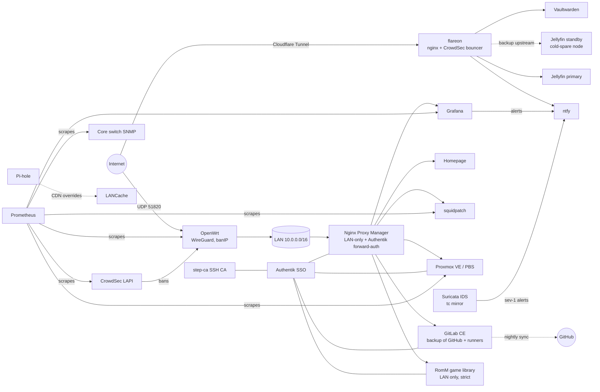

# Architecture (overview)

- **Nodes:** a Proxmox VE cluster of always-on nodes plus cold spares, sharing a ZFS storage; two PBS servers (hot + mirror on a cold spare, hourly pull sync while it's on). More detail in [diagrams.md](diagrams.md).
- **Public surface:** only the Cloudflare Tunnel (a handful of hostnames, all behind CrowdSec with custom brute-force scenarios) and the WireGuard port.
- **Everything else** is LAN/VPN only: local DNS on Pi-hole + the router, NPM access lists, Proxmox firewall IP sets (`lan`, `vpn`), and Authentik in front of admin UIs.
- **Git:** GitHub stays the primary; a self-hosted GitLab CE keeps a nightly, never-deleting copy of every repo and provides CI runners on homelab hardware ([gitlab/](../gitlab)).
- **Games:** a strictly LAN-only RomM library over the archive and a LANCache download cache steered by Pi-hole ([games/](../games)).

More: **[network.md](network.md)** (addressing, DNS, access tiers, firewall layers, VPN, IDS) and **[services.md](services.md)** (dependency map, request walk-throughs, per-service table, failure impact).

