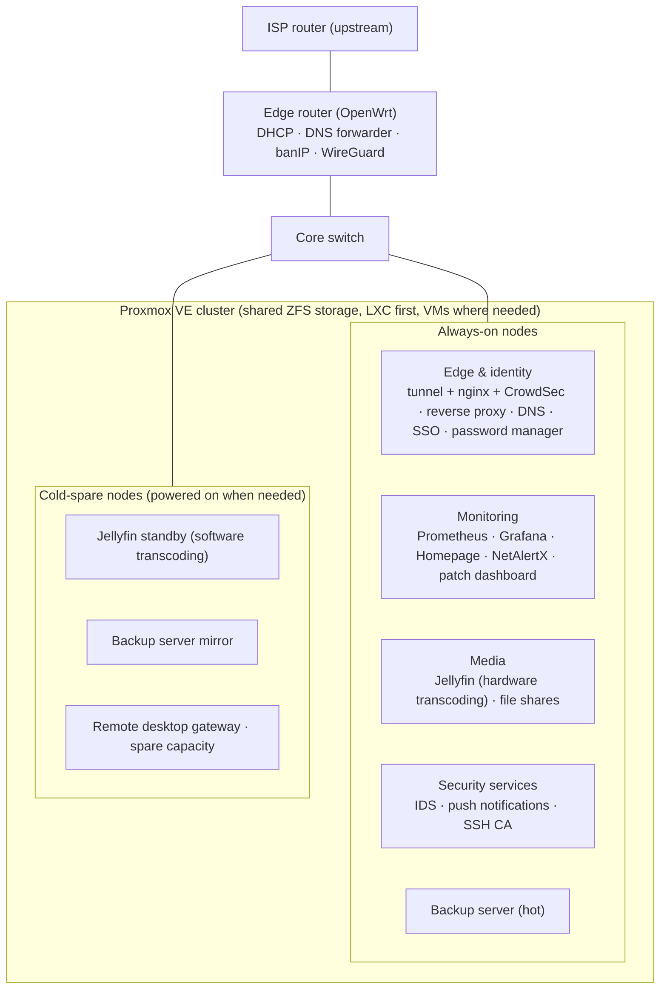
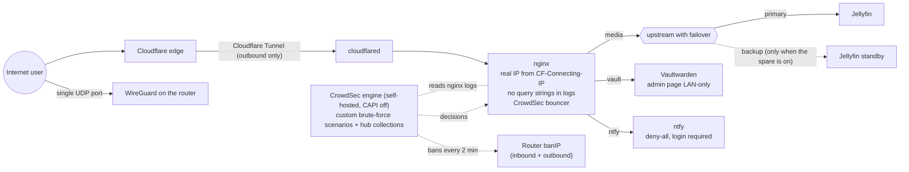
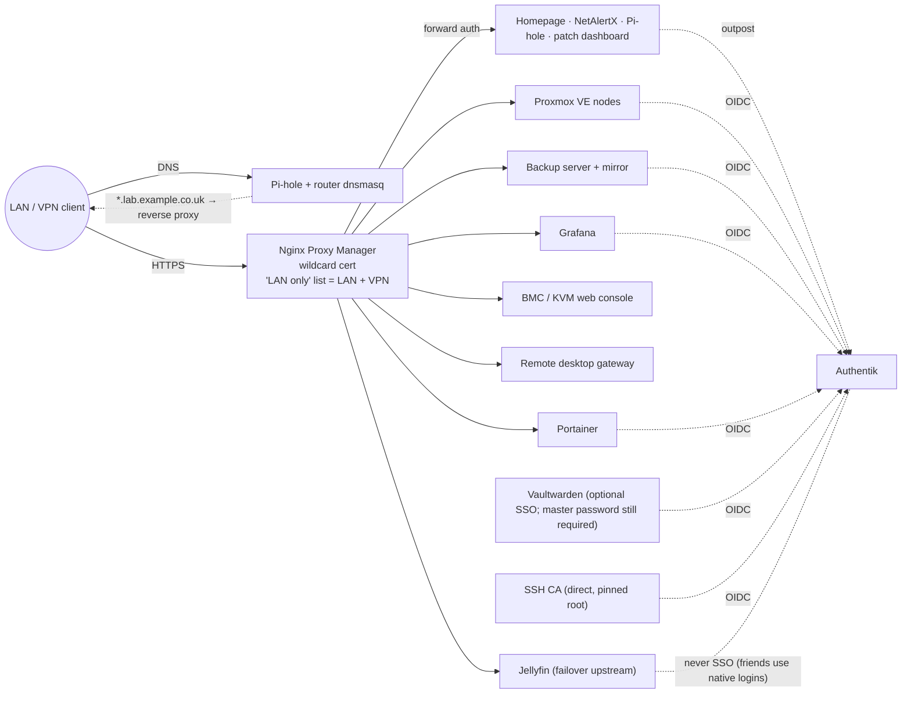
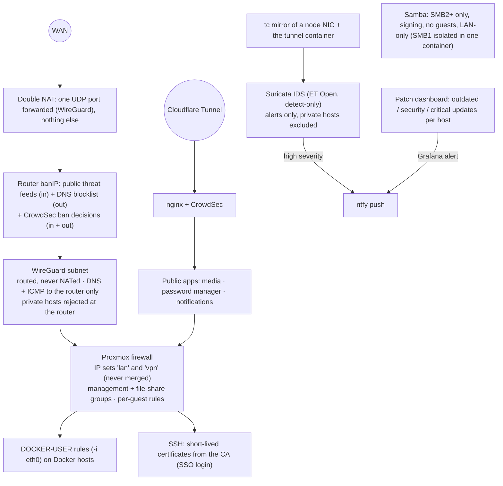
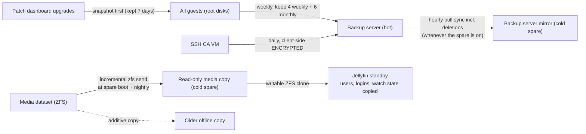
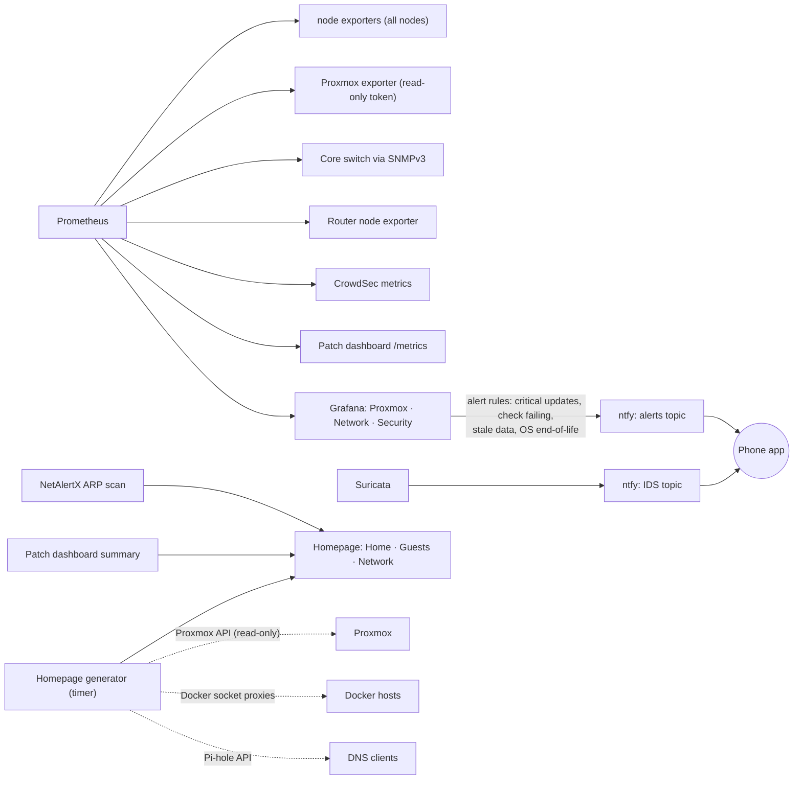
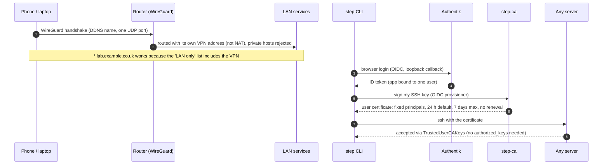

# Diagrams

Mermaid diagrams of the setup (GitHub renders them inline). Deliberately generic: roles, not hardware.
Domains are placeholders - `example.co.uk` is public, `lab.example.co.uk` is LAN/VPN-only.

1. [Platform](#1-platform)
2. [Public ingress](#2-public-ingress)
3. [LAN access, DNS and SSO](#3-lan-access-dns-and-sso)
4. [Security layers](#4-security-layers)
5. [Backups and resilience](#5-backups-and-resilience)
6. [Monitoring, alerting and inventory](#6-monitoring-alerting-and-inventory)
7. [Remote access and SSH certificates](#7-remote-access-and-ssh-certificates)

## 1. Platform

## 2. Public ingress

## 3. LAN access, DNS and SSO

## 4. Security layers

## 5. Backups and resilience

## 6. Monitoring, alerting and inventory

## 7. Remote access and SSH certificates

