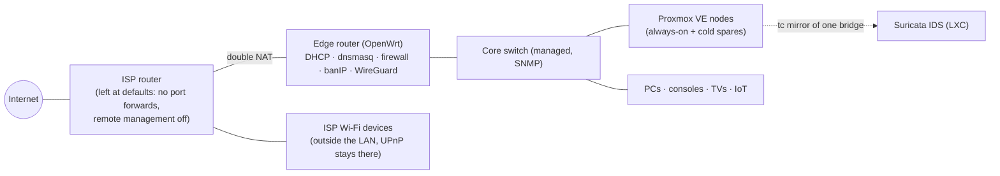
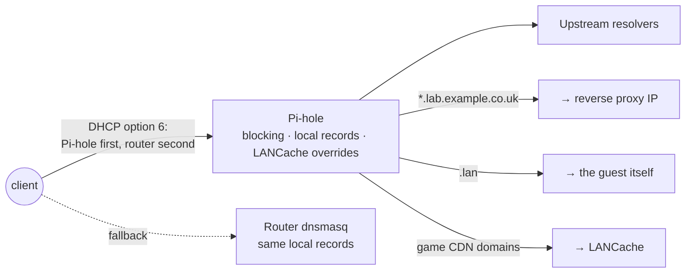
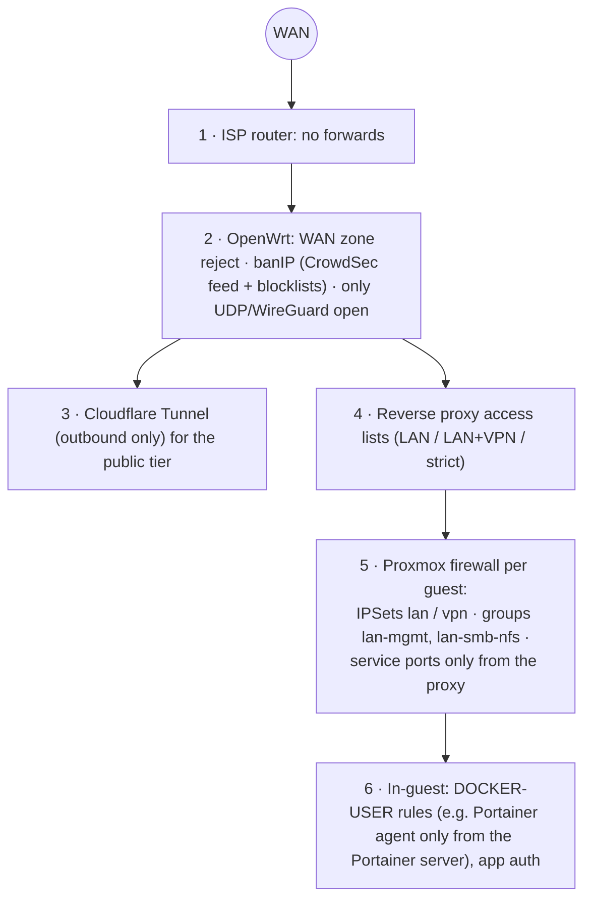

# Network

How the LAN is laid out, how names resolve, who can reach what, and the layers that enforce it.
Deliberately generic: roles and ranges, no hardware or public addresses. Domains are placeholders
(`example.co.uk` public, `lab.example.co.uk` LAN/VPN-only).

## 1. Topology

- **Double NAT, on purpose.** The ISP router stays stock; the OpenWrt edge router owns the real LAN. Nothing inbound is forwarded except the single WireGuard UDP port; public web services leave through an **outbound** Cloudflare Tunnel instead.
- Devices that need UPnP (some consoles, smart-home gear) can sit on the ISP Wi-Fi, outside the LAN.
- IPv6: the edge router has a public prefix on WAN; inbound IPv6 is rejected by default.

## 2. Addressing

One flat `10.0.0.0/16`, carved by convention into /24 "zones" (VLANs are a planned next step, see §9):

| Range | Use | Rule |
|---|---|---|
| `10.0.0.0/24` | **Core static**: router, nodes, BMCs, DNS, proxy, identity, monitoring, key services | static addresses end in **0 or 5** (`.25`, `.40`, `.65`…) so they're easy to spot |
| `10.0.1.0/24` | **Static overflow** for servers/containers once the core /24 filled up | same 0/5 rule |
| `10.0.2.0/24` | **DHCP pool** (router, 12 h leases) for everything dynamic | never hand-assign here |
| `10.100.0.0/24` | **WireGuard road-warrior clients** | routed (no NAT), own firewall identity |

- Every static guest also gets a **DHCP reservation** on the router (MAC → IP), so a guest that falls back to DHCP still lands on its address, and an IP inventory spreadsheet is regenerated from the cluster.
- Containers keep their MAC across migrations/restores, so reservations survive moves between nodes.

## 3. DNS (split-horizon)

- **`lab.example.co.uk`** names exist only on the LAN DNS (Pi-hole + router). Every one of them points at the **reverse proxy**, never at a backend, so TLS, access lists and SSO are applied in one place. They do not exist in public DNS at all.
- **`<host>.lan`** names point straight at a guest; used for SSH, git-over-SSH and things that must bypass the proxy.
- Public names (`example.co.uk`) exist only for the handful of tunnelled services.
- Both Pi-hole and the router carry the same local records, so the secondary resolver gives the same answers. The **LANCache overrides live only on Pi-hole** (a client that asks the router simply misses the cache - harmless).
- Pi-hole v6 extra dnsmasq files: enabling `misc.etc_dnsmasq_d` loads *everything* in `/etc/dnsmasq.d` - audit that folder first (a forgotten PXE file once switched on a TFTP server).

## 4. Access tiers

Every service is in exactly one tier. The tier decides DNS, proxy access list and firewall rules.

| Tier | Who | How it's enforced | Examples |
|---|---|---|---|
| **Public** | anyone on the internet | Cloudflare Tunnel → nginx + CrowdSec; app login; admin paths blocked | media server, password manager, push notifications |
| **LAN + VPN** | home LAN and WireGuard clients | proxy access list "LAN only" (`10.0.0.0/16` + VPN range); no public DNS | admin UIs, monitoring, git server, backups UI |
| **LAN only (strict)** | home LAN, **not** VPN | proxy access list without the VPN range; guest firewall | game library |
| **Private** | specific LAN hosts only | guest firewall allow-lists, `lan` IPSet only, never proxied publicly, never on VPN | personal containers |

## 5. Firewall layers (outside → in)

- **Proxmox cluster firewall** defines IPSets `lan` (`10.0.0.0/16`) and `vpn` (`10.100.0.0/24`) and shared groups:
  - `lan-mgmt` - SSH / PVE / PBS UIs from `lan` + `vpn`, dropped from anything else;
  - `lan-smb-nfs` - SMB/NetBIOS/NFS/rpcbind from `lan` only.
- **Per-guest pattern** for anything behind the proxy: `IN ACCEPT -source <proxy> -dport <app>`, then `DROP` that port, then `GROUP lan-mgmt`. So even a LAN client can't skip the proxy (and its SSO).
- The `vpn` IPSet is **never** part of `lan`: private hosts trust `+lan` only.
- Gotcha: a comment on a section header (`[RULES] # …`) silently voids the whole section in Proxmox's `.fw` parser - always verify with `pve-firewall compile` and `iptables-save` after an edit.

## 6. VPN

- WireGuard runs on the edge router (no inbound needed anywhere else, works through double NAT with one forward).
- **Routed, not NATed**: VPN clients keep their own `10.100.0.x` address, so every firewall layer can tell them apart from LAN clients.
- Peers are created with a helper that prints a QR code; the router's public name is kept current by DDNS.

## 7. Intrusion detection and bans

- **Suricata** (ET Open rules) watches a `tc` mirror of a node bridge; private containers and the bulk backup target are excluded by MAC; high-severity alerts go to ntfy.
- **CrowdSec** reads the public nginx logs (custom brute-force scenarios per app, central API off); decisions are applied by the nginx bouncer **and** pushed to the router's banIP every 2 minutes, so a banned IP is dropped at the edge for everything.

## 8. Remote and out-of-band access

- SSH everywhere uses **short-lived certificates** from a self-hosted step-ca, issued after an Authentik login (24 h default, 7 days max); nodes and guests trust the user CA via `TrustedUserCAKeys`.
- Node BMCs are LAN-only and reached through a bastion container (old cipher suites isolated there).

## 9. Planned

- **VLANs** on the managed switch: management/BMC, servers, clients, IoT, guests - turning today's /24 conventions into enforced segments.
- PXE boot (netboot) once VLANs exist.

## 10. Internal mail

An internal-only mail server (Stalwart) for service notifications: MX for the lab domain exists only on the LAN DNS; IMAPS/submission from LAN+VPN, plain SMTP from LAN only; outbound 25/465/587 dropped at the guest firewall and relaying limited to the local domain, so nothing can leave for the internet. The web UI sits behind the proxy with an Authentik forward-auth gate; TLS reuses the proxy's wildcard certificate, copied nightly. Planned: OpenPGP encryption at rest and webmail with Authentik SSO.
