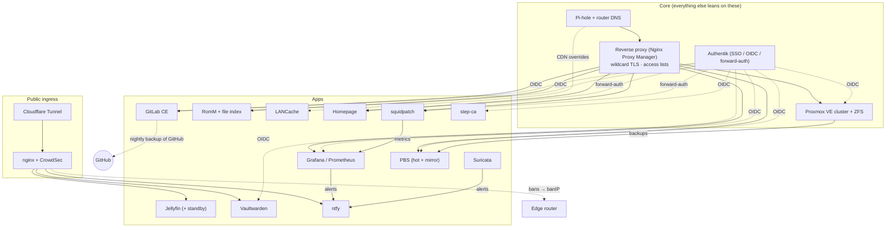
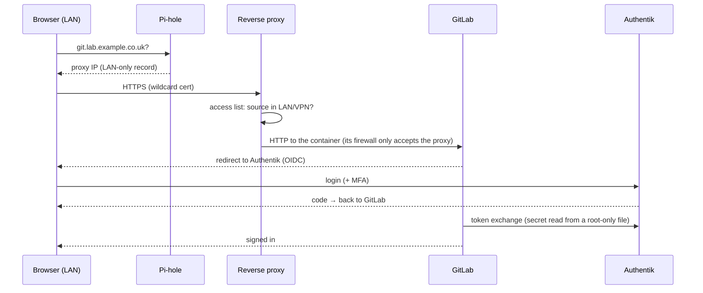
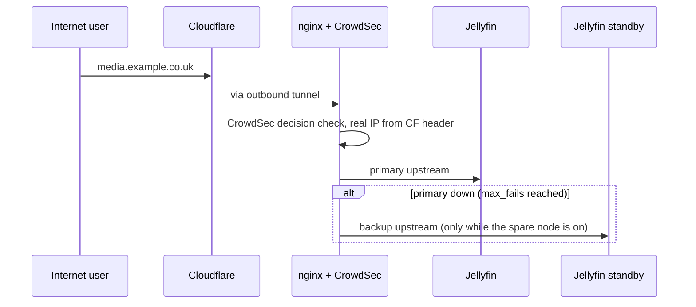

# Services and how they link

What depends on what, how a request actually travels, and what breaks when something is down.
Roles only; see [network.md](network.md) for addressing, DNS and firewall layers.

## 1. Dependency map

## 2. Request walk-throughs

**LAN admin opening a git repo (SSO):**

**Internet user streaming media (with failover):**

**Game download through the cache:** client asks Pi-hole for a Steam/Epic/… CDN host → gets the LANCache IP → downloads over HTTP from LANCache → on a miss LANCache fetches from the real CDN (using public resolvers, never Pi-hole) and keeps it; the next client gets it at LAN speed.

## 3. Service table

| Service | Tier | Login | Depends on | Backed up by | Watched by |
|---|---|---|---|---|---|
| Reverse proxy (NPM) | core | NPM admin (LAN) | DNS | weekly PBS + DB copy before edits | Homepage, Prometheus |
| Pi-hole / router DNS | core | admin UI (LAN) | upstream resolvers | PBS / router config backup | Homepage |
| Authentik | LAN+VPN | itself (+MFA) | Postgres, proxy | weekly PBS | Homepage, Grafana |
| Jellyfin + standby | public | native accounts (no SSO by design) | tunnel, storage | ZFS send to spare (incremental) | Homepage |
| Vaultwarden | public (admin LAN-only) | master password (+ optional SSO) | tunnel | weekly PBS | CrowdSec scenario |
| ntfy | public (deny-all) | tokens | tunnel | weekly PBS | - |
| GitLab CE | LAN+VPN | Authentik OIDC | proxy, Authentik | daily `gitlab-backup` + `backup-etc` → PBS; it *is* the GitHub backup | sync failures → ntfy |
| GitLab Runners ×2 | internal | runner tokens | GitLab | rebuildable | GitLab UI |
| RomM + file index | LAN only (strict) | Authentik OIDC | proxy, archive dataset | library = archive data; app via PBS | Homepage |
| LANCache | LAN (via DNS) | none | Pi-hole overrides | not needed (cache) | - |
| Mail (Stalwart, internal only) | LAN+VPN (web UI behind Authentik forward-auth) | own accounts (OIDC planned via webmail) | local DNS + MX, proxy wildcard cert (synced nightly) | weekly PBS | - |
| Prometheus / Grafana / Homepage | LAN+VPN | Authentik | proxy, exporters | weekly PBS + dashboards in git | - |
| squidpatch | LAN+VPN | forward-auth (admin) | SSH to nodes | git | Grafana alerts |
| step-ca | LAN+VPN | Authentik OIDC | Authentik | weekly PBS | - |
| Suricata | internal | - | bridge mirror | git | ntfy alerts |
| PBS hot + mirror | LAN+VPN | Authentik OIDC | storage | mirror pulls from hot (hourly while on) | Grafana |

## 4. If X is down…

| Down | Effect | Mitigation |
|---|---|---|
| Pi-hole | LAN names fail on the primary resolver | router dnsmasq has the same local records (DHCP hands out both) |
| Reverse proxy | all `lab.*` UIs unreachable | services still reachable on their `.lan` names from management hosts; SSH unaffected |
| Authentik | SSO logins fail | local admin accounts kept as break-glass on proxy, PVE, PBS, GitLab (root), RomM |
| Jellyfin primary | public media | automatic failover to the standby while the spare node is on |
| GitHub | nothing internal | GitLab holds a full copy (branches, tags, archived repos) |
| LANCache | game downloads on Pi-hole clients fail (DNS still points at the cache) | restart it, or move the override file out of `/etc/dnsmasq.d` and restart Pi-hole to send clients straight to the CDNs |
| A node | its guests | backups on PBS; standby services on cold spares; quorum survives one node |
